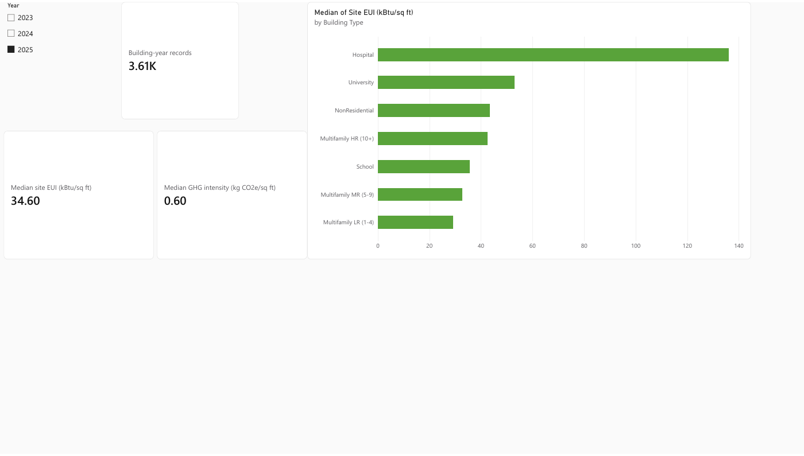
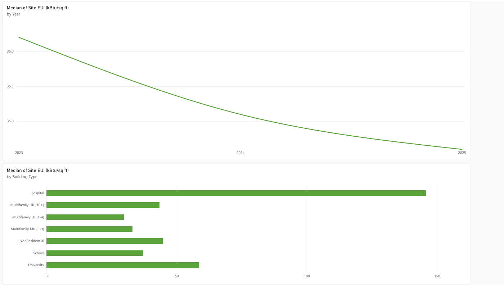

# Seattle Building Energy | Power BI benchmark review

A two-page Power BI report and reproducible Python analysis of Seattle's public building-energy benchmarking records for 2023–2025. The report pairs a 2025 KPI view with a year trend and a building type → neighborhood drill path.



**Explore:** [Power BI report](https://app.powerbi.com/groups/e6426da3-9b36-4519-acf1-2434daa552ae/reports/c5e01161-c12d-49db-9ddc-388608924916/113c2f28d5d6b4458da2?experience=power-bi) · [two-page PDF export](reports/seattle-building-energy-report.pdf) · [findings and caveats](reports/FINDINGS.md) · [second page preview](visuals/trends-neighborhoods.png)

> The Power BI workspace link may require Microsoft sign-in and access to the report. The PDF and page previews are public here.

## Business question

How does reported site energy-use intensity (EUI) vary over time and among building types and neighborhoods, and what should a reader check before interpreting a year-over-year change?

## Report design

| Page | What it shows | Interactions |
| --- | --- | --- |
| 2025 KPI Overview | Building-year count, median site EUI, median GHG intensity, and site EUI by building type | Year slicer and chart cross-filtering |
| Trends & Neighborhoods | Annual median site EUI and building-type comparison | Building Type → Neighborhood drill hierarchy and visual-level compliance filter |

The EUI and GHG figures are medians of compliant records with valid values; the building-year count includes all records in the selected year. The default year selection is 2025.



## Validated findings

- **11,009 building-year records**: 3,687 in 2023, 3,712 in 2024, and 3,610 in 2025. A building may appear in multiple years.
- Among compliant records with positive site EUI, the median was **36.2**, **35.1**, and **34.6 kBtu/sq ft** in 2023, 2024, and 2025, respectively. These are cross-sectional medians, so the included buildings can differ.
- Among **3,190** buildings with compliant, positive EUI in both 2024 and 2025, the median building-level change was **−0.5 kBtu/sq ft**; **59.72%** reported lower EUI in 2025. This is descriptive and does not identify a cause.
- In 2025, median reported site EUI was **29.25** for low-rise multifamily (n=1,000), **43.4** for non-residential (n=1,221), and **136.25** for hospitals (n=44). Different building uses make these unsuitable as a simple performance ranking.

Full definitions, denominator rules, data-quality notes, and limitations are in [FINDINGS.md](reports/FINDINGS.md). The reproducible totals are in [summary.json](analysis/summary.json).

## Data and reproducibility

**Source:** City of Seattle, [Building Energy Benchmarking Data 2015–Present](https://data.seattle.gov/Built-Environment/Building-Energy-Benchmarking-Data-2015-Present/teqw-tu6e), accessed 3 November 2026. The source is public data; its records are owner reported and can be revised. The extract covers calendar years 2023–2025 and properties subject to Seattle's benchmarking program, generally multifamily and non-residential buildings above 20,000 square feet. It is not a census of all Seattle buildings.

The committed [curated CSV](data/seattle_benchmarking_2023_2025.csv) is the Power BI input. [Extract metadata](data/extract_metadata.json) records source and extraction details. To refresh and validate with Python 3 (standard library only):

```bash
python scripts/fetch_data.py
python scripts/analyze.py
```

The first command retrieves the source fields; the second creates the curated CSV and `analysis/summary.json`. The raw intermediate is excluded from Git. The published report was connected to the committed CSV's GitHub raw URL. A refreshed extract can differ as the City revises records.

## Interpretive limits

Site EUI is annual on-site energy divided by gross floor area; the report uses the unadjusted field, not weather-normalized EUI. Compliance means the benchmarking requirement was met, not that energy performance was good. Missing and nonpositive EUI values are excluded from median EUI calculations, while extreme positive values are flagged and retained. GHG intensity is a separate metric and is not summed. No causal claim is made about retrofits, policy, weather, or building management.

